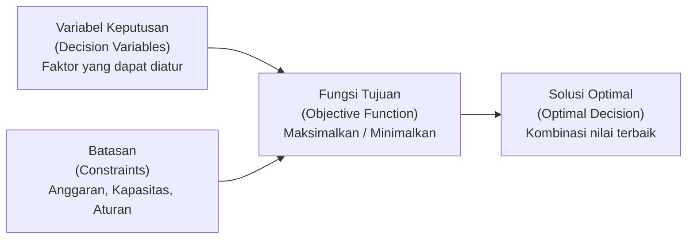

*Seri: Optimasi di Teknik Industri, Hari #1. Topik 1.1: What and Where Do We Optimize?* · [Read in English]({{ '/blog/2026/optimization-experts-in-everyday-life/' | relative_url }})

Pada kehidupan sehari-hari, kita sering dihadapkan pada beberapa pilihan. Tidak jarang pilihan ini membuat kita bingung dalam mengambil keputusan. Contoh, ketika ingin membeli rumah, kita dihadapkan pada pilihan rumah yang luas tetapi jauh dari tempat kerja, atau rumah yang mungil tetapi dekat dengan pusat kota. Tentu saja, keputusan ini dipersulit dengan ketersediaan dana yang kita miliki. Atau contoh lain, ketika memilih kendaraan, kita harus menimbang antara harga unit, tingkat penggunaan bahan bakar apakah boros atau tidak, kenyamanan, serta *after-sales service*.

Hal serupa juga terjadi saat kita memilih makanan, pakaian, laptop, profesi, hingga kota tempat tinggal. Secara alami, kita tentu selalu menginginkan pilihan yang paling baik. Namun, karena adanya keterbatasan sumber daya dan berbagai batasan (*constraints*), kita tidak selalu bisa mendapatkan yang terbaik dalam segala aspek. Sebagai gantinya, kita memilih opsi yang **paling optimal**, yaitu keputusan terbaik yang paling masuk akal dengan mempertimbangkan prioritas, sumber daya, dan batasan yang ada. Proses inilah yang disebut sebagai **optimasi**.

### Memahami "Pengorbanan" Lewat Desain Kendaraan

Dalam sudut pandang rekayasa (*engineering*), optimasi juga dapat dipahami sebagai cara kita menentukan "biaya" atau pengorbanan apa yang bersedia kita tanggung demi memperoleh manfaat yang diharapkan. Kita bisa melihat contoh nyatanya pada bagaimana para insinyur merancang berbagai jenis mobil di industri otomotif:

- **Mobil Sport (*Sports Car*):** Jika tujuannya adalah memaksimalkan akselerasi, maka perancang perlu memaksimalkan tenaga mesin sekaligus meminimalkan bobot kendaraan dengan ukuran bodi yang ringkas. Konsekuensinya, pengemudi harus menerima pengorbanan berupa konsumsi bahan bakar yang boros dan biaya perawatan yang tinggi.
- **Mobil Hemat Bahan Bakar:** Sebaliknya, untuk meminimalkan konsumsi bahan bakar, mobil umumnya dirancang berukuran kecil dengan mesin berdaya rendah, sehingga akselerasinya tidak secepat mobil sport.
- **Mobil Keluarga (*Family Car*):** Pada jenis ini, perancang berusaha menjaga keseimbangan antara akselerasi dan efisiensi bahan bakar, sembari memenuhi batasan wajib berupa kapasitas angkut penumpang yang banyak, misalnya harus mengakomodasi tiga baris kursi.
- **Truk Kargo:** Truk dibekali mesin yang sangat bertenaga untuk mengangkut beban berat, tetapi karena ukurannya yang besar, akselerasinya menjadi yang paling rendah di jalan raya.

Lalu, muncul pertanyaan menarik: *mungkinkah kita membuat truk kargo yang memiliki akselerasi secepat mobil sport?* Secara teknis, hal itu sangat mungkin dilakukan dengan memasang mesin berukuran raksasa. Namun, pabrikan tidak melakukannya karena berdasarkan perhitungan, biaya produksinya akan sangat mahal dan volume penjualannya bakal rendah. Artinya, keputusan tersebut tidak optimal secara ekonomi maupun teknis.

Di sisi konsumen, pola pikir optimasi yang sama juga berlaku. Ada orang-orang yang memilih untuk tidak mengalokasikan terlalu banyak dana pada pembelian mobil, agar sisa sumber daya finansialnya bisa digunakan untuk kebutuhan lain yang dianggap lebih penting atau lebih mereka nikmati.

### Membawa Persoalan Nyata ke dalam Model Matematika

Di bidang Teknik Industri dan Manajemen, prinsip optimasi menjadi fondasi utama dalam pengambilan keputusan. Misalnya, bagaimana meminimalkan biaya produksi suatu barang tanpa mengurangi standar kualitas yang ditetapkan, bagaimana memaksimalkan keuntungan perusahaan di bawah keterbatasan anggaran, atau bagaimana mengatur pembagian tugas karyawan secara efisien.

Agar persoalan-persoalan nyata tersebut dapat diselesaikan secara sistematis, kita perlu menerjemahkannya ke dalam bahasa matematika. Proses ini disebut sebagai **pemodelan (*modeling*)**. Secara garis besar, setiap model optimasi terdiri dari tiga elemen utama:

1. **Variabel Keputusan (*Decision Variables*):** Faktor atau nilai yang dapat kita atur dan tentukan besarannya (misalnya x₁, x₂, …, xₙ), seperti kapasitas mesin atau jumlah unit yang dipesan.
2. **Fungsi Tujuan (*Objective Function*):** Ukuran kinerja utama f(x) yang ingin kita maksimalkan (seperti keuntungan atau akselerasi) atau minimalkan (seperti biaya produksi atau waktu tunggu), yang nilainya dipengaruhi oleh variabel keputusan.
3. **Batasan (*Constraints*):** Kondisi atau aturan main yang membatasi ruang gerak keputusan kita, misalnya batas anggaran, kapasitas gudang, atau jumlah kursi penumpang.

Tujuan dari metode optimasi bukan hanya mencari berapa nilai maksimum atau minimum dari fungsi tujuan tersebut, melainkan menemukan **kombinasi nilai variabel keputusan** yang menghasilkan kondisi paling optimal. Pada pembahasan-pembahasan berikutnya, kita akan mengenal lebih jauh berbagai karakteristik masalah optimasi, mulai dari yang bersifat linear hingga non-linear, cembung (*convex*) hingga non-cembung, serta yang memiliki satu titik optimal (*unimodal*) maupun banyak titik optimal lokal (*multimodal*), dengan pendekatan yang bertahap dan mudah dipahami.

---

### Referensi

Cuevas, E., Rosas Caro, J. C., Alejo Reyes, A., González Ayala, P., & Rodriguez, A. (2025). *Optimization in Industrial Engineering: From Classical Methods to Modern Metaheuristics with MATLAB Applications* (Chapter 1, Section 1.1: What and Where Do We Optimize, pp. 1–3). Springer Nature.
