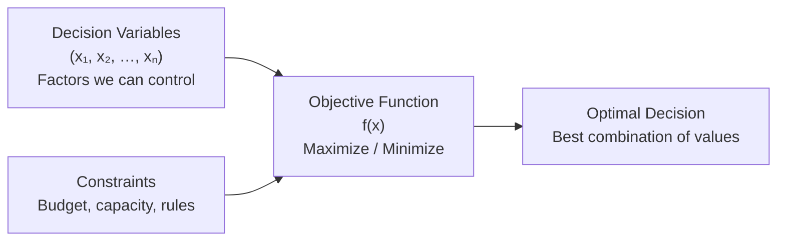

*Series: Optimization in Industrial Engineering, Day #1. Topic 1.1: What and Where Do We Optimize?* · [Baca dalam Bahasa Indonesia]({{ '/id/tulisan/2026/ahli-optimasi-kehidupan-sehari-hari/' | relative_url }})

In our daily lives, we are frequently faced with multiple choices. Quite often, these choices make it difficult for us to reach a decision. For example, when we want to buy a house, we might be torn between a spacious home that is far from our workplace, or a smaller house located right near the city center. Of course, this decision is further complicated by the funds we have available. Another example is when we choose a vehicle: we have to weigh the purchase price, fuel consumption efficiency, driving comfort, and after-sales service.

The same pattern appears when we select food, clothing, computers, a career, or even a city to live in. Naturally, we always prefer the best possible options. However, because we constantly operate under limited resources and constraints, we cannot always get the absolute best in every single aspect. Instead, we settle on the **optimal option**: the best decision we can make after carefully weighing our priorities, resources, and constraints. This everyday decision-making process is what we call **optimization**.

### Understanding "Trade-Offs" Through Vehicle Design

From an engineering standpoint, optimization can also be understood as deciding what cost or sacrifice we are willing to accept in order to obtain a desired benefit. We can see clear evidence of this in how automotive engineers design different types of vehicles:

- **Sports Cars:** When the goal is to maximize acceleration, designers need to maximize engine power while minimizing vehicle weight through a compact body. The trade-off is that drivers accept higher fuel consumption and more expensive maintenance.
- **Fuel-Efficient Cars:** Conversely, to minimize fuel consumption, cars are typically built smaller with low-power engines, sacrificing high acceleration in the process.
- **Large Family Cars:** Here, engineers aim to maintain a balance between acceleration and fuel economy while meeting a strict constraint: carrying multiple passengers, often requiring three rows of seats.
- **Cargo Trucks:** Trucks are equipped with very powerful engines to haul heavy cargo, yet because of their massive size, they end up with the lowest acceleration in practice.

This raises an interesting question: *would it be possible to design a cargo truck with the acceleration of a sports car?* Technically, yes, by manufacturing an enormous engine. However, manufacturers choose not to do this because their calculations show that production costs would be far too high and sales volume would be low. Simply put, such a design would not be optimal.

On the consumer side, the exact same optimization logic applies. Many people intentionally avoid spending too much of their budget on a car so they can allocate those financial resources toward other expenses they consider more important or enjoyable.

### Translating Real-World Problems into Mathematical Models

In Industrial Engineering and Management, optimization serves as a core tool for strategic decision-making. Common examples include minimizing the production cost of a product while maintaining a specific quality level, maximizing company profits under budget constraints, or allocating employees to different tasks as efficiently as possible.

To solve these physical, real-world situations systematically, we first need to express them in mathematical terms, a process known as **modeling**. In general, every optimization model consists of three main components:

1. **Decision Variables:** The independent inputs we can control or adjust (such as x₁, x₂, …, xₙ), like engine size or order quantity.
2. **Objective Function:** The primary performance measure f(x) we want to maximize (such as profit or acceleration) or minimize (such as cost or waiting time), which depends on our decision variables.
3. **Constraints:** The real-world limitations or conditions that bound our decisions, such as budget caps, storage capacity, or seating requirements.

The goal of an optimization algorithm is not merely to find the minimum or maximum value of the objective function, but to determine the **exact values of the decision variables** that produce that optimal outcome. As we move forward in this series, we will gradually explore different types of optimization problems, ranging from linear to nonlinear, convex to non-convex, and single-peak (*unimodal*) to multi-peak (*multimodal*), in a clear and approachable manner.

---

### Reference

Cuevas, E., Rosas Caro, J. C., Alejo Reyes, A., González Ayala, P., & Rodriguez, A. (2025). *Optimization in Industrial Engineering: From Classical Methods to Modern Metaheuristics with MATLAB Applications* (Chapter 1, Section 1.1: What and Where Do We Optimize, pp. 1–3). Springer Nature.
